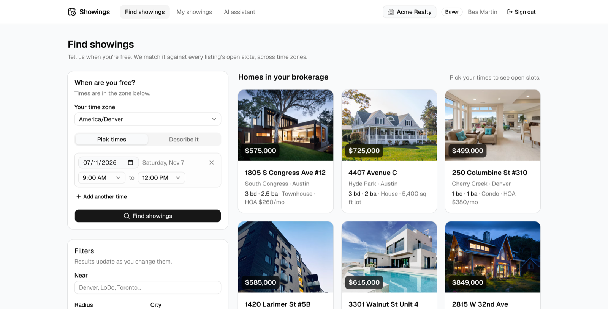
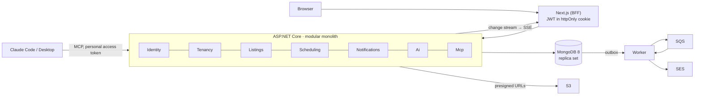

# Home Showing Scheduler

A two sided scheduling app for real estate brokerages. **Agents** publish listings with the days and times a
home can be shown. **Buyers** say when they are free, in their own time zone, in words or with a picker, and
see only the listings with openings that fit, ranked by fit and distance, and book a slot. Every booking is
protected from double booking by the database, every document belongs to one brokerage, and the whole scheduler
is also an **MCP server**, so a buyer can find and book showings from Claude Code or Claude Desktop.



Author: **Roberto Espinoza**.

## Quick start

Needs Docker only. No API keys, no accounts.

```bash
git clone <this repo> home-showing-scheduler
cd home-showing-scheduler
cp .env.example .env
docker compose up --build
```

Then open **http://localhost:3000**. The seed runs automatically: two brokerages, ten listings in Denver, Austin
and Toronto with different showing rules, demo users and a few showings. The API with its Scalar reference is at
**http://localhost:5080** (`/scalar`), LocalStack at `:4566`.

| Demo login (password `demo1234`) | Role | Sees |
|---|---|---|
| `admin@acme.test` | Brokerage admin, Acme Realty (Denver, Austin) | agents, all listings and showings, outbox and emails |
| `agent@acme.test` | Agent, Acme Realty | own listings, showing rules editor, live inbox |
| `buyer@acme.test` | Buyer, Acme Realty | search, book, My showings, AI assistant tokens |
| `agent@northstar.test` / `buyer@northstar.test` | Northstar Homes (Toronto) | only Northstar data |

The login page has one click buttons for each. The header always shows the current brokerage and role.

## Features by role

**Agent (seller side)**
* My listings as photo cards; a listing editor with address, price, per type attributes (HOA and floor for condos,
  lot size for houses), photos, IANA time zone and coordinates.
* Showing rules: a weekly window grid, slot length, buffer, lead time, horizon, blackout dates, auto confirm, with a
  live preview of the next open slots.
* A showings inbox with approve and decline that updates **live** (MongoDB change stream → Server Sent Events).
* "Connect an AI assistant": personal access tokens for the agent MCP tools (list requests, respond, schedule).

**Buyer**
* Availability in two modes: a range picker, or a sentence ("weekday evenings after 6 except Thursday, Saturday
  morning") parsed into windows the buyer **reviews before searching**.
* Filters: near a place (geospatial, sorted by distance), city, price, beds, type.
* Listing cards with slot chips grouped by day in the buyer's zone (the listing's local time shown when it differs),
  a listing detail page with a gallery, and "nearest open slots" when nothing matches.
* Booking with a 5 minute **slot hold** and countdown; a taken slot returns the three nearest alternatives.
* My showings, live; cancel. "Connect an AI assistant" for the buyer MCP tools.

**Brokerage admin**
* Agents list and invite; all listings; all showings; the outbox and sent emails (with a link to LocalStack's SES
  inbox).

## Architecture



* `apps/web`: Next.js App Router, Tailwind, shadcn/ui. A BFF: route handlers set the cookie and proxy to the API,
  including the SSE stream.
* `src/Api`: the host. `src/Modules/*`: one class library per module with `Domain`, `Application`,
  `Infrastructure`, `Endpoints`. `src/BuildingBlocks`: tenant context, `Result`, a small domain event dispatcher
  (no MediatR), outbox, audit, the tenant scoped repository base. `src/Worker`: outbox relay and delivery.
* MongoDB through the official driver. (Entity Framework's MongoDB provider was time boxed and checked: it does
  unique indexes and EF query filters, but this design also needs `$geoNear` aggregation, change streams,
  multi document transactions shared with the outbox, partial filter expressions and `$jsonSchema` validators,
  none of which the provider exposes, so the driver is used everywhere, behind a tenant scoped repository base.
  See ADR 002.)
* NodaTime for all time handling; UTC plus the listing's IANA zone in storage.

More in [docs/architecture.md](docs/architecture.md) and the [API contract](docs/api-contract.md).

## Key design decisions

| Decision | ADR |
|---|---|
| Modular monolith over microservices; modules talk through contracts and in process events | [001](docs/adr/001-modular-monolith.md) |
| MongoDB: listings as documents, 2dsphere geo search, change streams, TTL holds, and **no double booking through slot discretization plus a unique partial index** (and per bucket claims so the guarantee survives rule changes). Trade off versus Postgres exclusion constraints | [002](docs/adr/002-mongodb.md) |
| Shared collections with `tenantId` in the repository base; 404, never 403, across tenants | [003](docs/adr/003-multi-tenancy.md) |
| NodaTime; expand rules in local time, store UTC + zone; DST gaps skipped, overlaps offered once | [004](docs/adr/004-nodatime.md) |
| AI behind an interface with a deterministic fallback and human review of the parsed output | [005](docs/adr/005-ai-parser.md) |
| Transactional outbox → SQS → Worker → SES, idempotent delivery, LocalStack locally | [006](docs/adr/006-outbox-sqs-ses.md) |
| MCP as a second interface over the same application services; PATs; role filtered tools; confirmation annotations | [007](docs/adr/007-mcp-server.md) |

## The AI provider switch

`POST /ai/parse-availability` turns text into weekly windows. With `ANTHROPIC_API_KEY` set in `.env`, the parser is
**Claude Haiku (`claude-haiku-5-5`)** with a strict JSON schema; without it, a **deterministic rule based parser**
handles weekdays, weekends, day names, mornings, afternoons, evenings, "after N", "before N", "between A and B",
ranges and "except". The buyer screen shows which one is active, the output is validated server side either way,
and the buyer reviews the result before searching. If Claude fails, the rule based parser answers and says so.

## Book showings from Claude

The API is an MCP server at `http://localhost:5080/mcp` (Streamable HTTP). Create a token on the *AI assistant* page
and run the command it shows:

```bash
claude mcp add --transport http showings http://localhost:5080/mcp --header "Authorization: Bearer <token>"
```

Then ask Claude Code: *"Find me a Saturday morning showing in Denver under 600k and book it."* The booking appears
in the agent's inbox immediately. **No Anthropic key is needed on the server; your Claude client brings the
model.** Buyer tools: `search_listings`, `find_open_slots` (text or ranges), `book_showing`, `list_my_showings`,
`cancel_showing`. Agent tools: `list_showing_requests`, `respond_to_request`, `get_listing_schedule`. Read tools
carry `readOnlyHint`; booking, cancelling and responding do not, so the client asks before calling them.
A real transcript is in [docs/mcp-demo.md](docs/mcp-demo.md).

## Tests

```bash
dotnet test            # needs Docker: integration tests start a MongoDB 8 replica set with Testcontainers
cd apps/web && npm run lint && npm run build
cd apps/web && npx playwright install chromium && npm run test:e2e   # browser journeys against the running stack
```

* `Scheduling.Tests`: slot generation (basic, buffers, blackouts, lead time, horizon, a window ending at midnight),
  both DST transitions (2027-03-14 spring forward, 2026-11-01 fall back), a Toronto buyer against a Denver
  listing, matching and ranking, nearest slot suggestions, rules validation, the rule based parser.
* `Tenancy.Tests`: a user in brokerage A gets **404** on brokerage B's listing, slots, holds, bookings and
  showing actions; list, geo and match endpoints never return another tenant's documents; a forged role claim is
  rejected; a `tenantId` in the body is ignored.
* `Api.IntegrationTests`: **20 parallel bookings of one slot → 1 × 201 and 19 × 409**; the lifecycle (decline
  frees the slot, confirm, cancel, ownership); auto confirm writes the outbox rows in the same transaction; off grid
  times → 422; the `$jsonSchema` validator; holds (a second buyer cannot hold or book a held slot, release, TTL
  index, expiry lag); a slot length change cannot create an overlapping booking; the **MCP server through the
  official SDK client** (buyer token sees only buyer tools and books; brokerage B cannot see A; agent confirms;
  missing and revoked tokens get 401).
* `apps/web/e2e` (Playwright, against the seeded stack at `localhost:3000`): the agent journey (demo sign in,
  listings, the showing rules editor with its slot preview); the buyer journey (describe the week in words → parse
  → search near LoDo → open a listing → a slot hold with the countdown); and tenant isolation through the browser
  (a Northstar buyer pasting an Acme listing URL sees *not found*).

CI (`.github/workflows/ci.yml`) builds and tests the API, lints and builds the web app, then boots the whole stack
with `docker compose up --wait`, hits the health endpoints and runs the Playwright journeys against it.

## AWS

Locally, **LocalStack** (`localstack/localstack:4.12.0`, pinned to a tokenless image) provides S3, SQS and SES;
`deploy/localstack/init-aws.sh` creates the bucket (with CORS), the queue with its dead letter queue and the
verified sender.

* **S3**: listing photos through presigned PUT URLs (the browser uploads directly) and presigned GET URLs for display.
  Demo listings use external image URLs so the seed works offline.
* **Outbox → SQS → Worker → SES**: booking, confirm, decline and cancel write an outbox row in the same transaction as
  the showing; the Worker relays rows to SQS, consumes them and sends through SES. Delivery is idempotent (unique
  index on the outbox id) with exponential backoff and a DLQ. Sent emails show on the admin *Outbox and emails*
  page and at `http://localhost:4566/_aws/ses`.
* Real AWS is a configuration change (`Aws__ServiceUrl` empty, task role credentials). The production design, with
  Vercel, ECS Fargate behind an ALB, MongoDB Atlas (and a DocumentDB compatibility note), S3, SQS with DLQ, SES,
  Secrets Manager and CloudWatch alarms, is in [docs/aws-deployment.md](docs/aws-deployment.md).

## Known limitations

* Slots are discrete (a fixed grid per listing). Free form durations would need a range exclusion constraint,
  which MongoDB does not have; see ADR 002 for where that change would live.
* Photo upload to S3 works through LocalStack; there is no image resizing or CDN.
* Email delivery goes to LocalStack's SES, so nothing reaches a real inbox.
* The gazetteer for "near" is a small list of seeded cities and neighbourhoods, not a geocoder; coordinates can be
  passed directly.
* Rate limits are per client IP as forwarded by the BFF; there is no account lockout.
* One worker task; the design scales it on queue depth but that is not exercised here.

## Next steps

* **Semantic listing search with Atlas Vector Search** (the `mongodb/mongodb-atlas-local` image supports it
  locally): embed descriptions and let a buyer ask for "a bright loft near good coffee".
* Calendar sync for agents (Google / Outlook busy times feeding the slot generator) and ICS invites in the emails.
* A CDK stack for the AWS design, with per environment pipelines.
* Buyer notifications by SMS, and reminders the day before a confirmed showing.
* An "AI draft" button for listing descriptions.

## Repository layout

```
apps/web/                 Next.js app (BFF)
src/Api/                  host, auth wiring, composition root, demo seed
src/Modules/<Module>/     Identity, Tenancy, Listings, Scheduling, Notifications, Ai, Mcp
src/BuildingBlocks/       shared kernel
src/Worker/               outbox relay and delivery
tests/                    Scheduling.Tests, Tenancy.Tests, Api.IntegrationTests (Testcontainers)
deploy/localstack/        init-aws.sh
docs/                     architecture, API contract, ADRs, AWS design, demo script, MCP transcript
docker-compose.yml        mongo (replica set), localstack, api, worker, web
```
