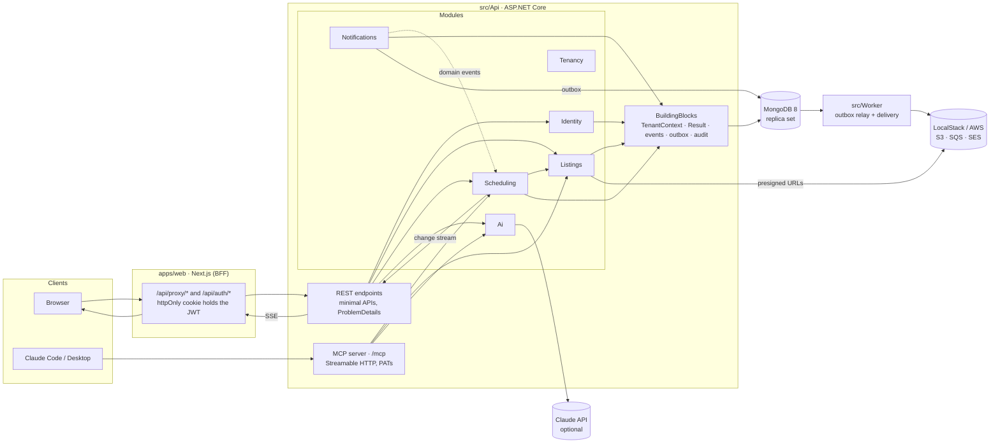

# Architecture

A modular monolith: one ASP.NET Core API with module boundaries enforced by project references, a Next.js
front end that acts as a BFF, a worker for the outbox, and MongoDB as the single store. Two delivery interfaces,
REST and MCP, sit on the same application services.

## Request path

1. The browser calls a Next.js route handler. The handler reads the `hss_session` cookie and forwards the
   request to the API with `Authorization: Bearer <jwt>`. The browser never sees the token.
2. The API authenticates (JWT, or a personal access token for MCP), copies `sub`, `tenantId` and `role` into the
   scoped `TenantContext`, and runs the endpoint.
3. Endpoints call an application service and map its `Result<T>` to a response. Services never throw for
   expected failures; `Error` kinds map to 400 / 401 / 403 / 404 / 409 / 422 ProblemDetails.
4. Repositories extend `TenantScopedRepository<T>`, which adds `tenantId` to every filter and insert.

## Modules

| Module | Owns | Exposes |
|---|---|---|
| Tenancy | `tenants` | `ITenantDirectory` |
| Identity | `users`, `personalAccessTokens`; JWT and PAT authentication; policies | `AuthService`, `IUserDirectory` |
| Listings | `listings` (2dsphere index, `$jsonSchema`); photo storage | `IListingCatalog`, `ListingService`, `ShowingRules` contracts |
| Scheduling | `showings`, `slotClaims`, `slotHolds`; slot generation, matching, booking lifecycle, change feed | `AvailabilityService`, `BookingService`, events |
| Notifications | handlers that turn scheduling events into outbox rows; `sentEmails` | admin outbox endpoint |
| Ai | `IAvailabilityParser` (Claude or rule based) | `AvailabilityParsingService` |
| Mcp | tools, role filters, tool annotations | `/mcp` |

Modules reference each other's `Application` and `Contracts` only. The dispatcher in BuildingBlocks delivers
domain events in process, inside the caller's transaction.

## Scheduling in one paragraph

A listing's rules are weekly windows in the listing's IANA zone. `SlotGenerator` expands them for the horizon,
in local time, mapping each start to an instant (DST gaps skipped, overlaps offered once), stepping by
`slotMinutes + bufferMinutes`, dropping blackout dates and anything inside the lead time, then subtracting
active showings and other buyers' live holds. `Matcher` keeps the slots that fit entirely inside the buyer's
ranges (converted from the buyer's zone), ranks listings by matching slots and groups by day in the buyer's zone.
Booking inserts a showing with `activeSlotKey` (unique partial index: same slot, one winner) plus one claim per
5 minute bucket (unique per listing: no overlap, even after the grid changes), the outbox row and an audit entry,
all in one transaction. Decline and cancel unset the key and delete the claims.

## Live updates

`GET /showings/stream` opens a MongoDB change stream on `showings`, filtered server side by tenant and by the
caller (agent id or buyer id), and writes Server Sent Events. The resume token is the SSE `id`, so a reconnect
with `Last-Event-ID` continues where it stopped. The Next.js proxy streams the response through without buffering.

## Data

| Collection | Key indexes |
|---|---|
| `listings` | `location` 2dsphere; `(tenantId, ownerUserId)`; `(tenantId, status, city, price)` |
| `showings` | **unique partial** `(tenantId, activeSlotKey)` where the key exists; `(tenantId, agentId, slotStartUtc)`; `(tenantId, buyerId, slotStartUtc)` |
| `slotClaims` | **unique** `(tenantId, listingId, bucketStartUtc)` |
| `slotHolds` | TTL on `expiresAt`; unique `(tenantId, activeSlotKey)` |
| `users` | unique `email`; `(tenantId, role)` |
| `personalAccessTokens` | unique `hash` |
| `outbox` | `(processedAt, occurredAt)` |
| `sentEmails` | unique `outboxId` (idempotent delivery) |

## Testing

* `tests/Scheduling.Tests`: pure unit tests for the generator, matcher, rules validation and the rule based parser,
  including both DST transitions and a Toronto buyer against a Denver listing.
* `tests/Tenancy.Tests` and `tests/Api.IntegrationTests`: the real API in `WebApplicationFactory` against a
  Testcontainers MongoDB replica set. Tenant isolation (404 not 403, list endpoints, forged claims, body tenant
  ids), 20 way concurrent booking, lifecycle, holds and TTL, schema validators, grid change overlap, and the MCP
  server driven by the official SDK client.
