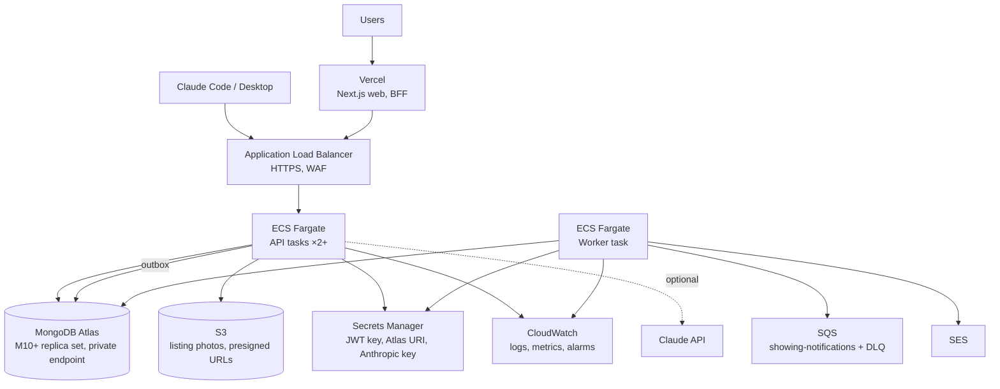

# AWS deployment (design target)

Locally the AWS pieces run in LocalStack (`docker compose up` starts it, `deploy/localstack/init-aws.sh`
creates the bucket, queue, DLQ and sender). The code uses the AWS SDK for .NET with a `ServiceURL` from
configuration, so moving to real AWS is configuration, not code. This document is the target shape.



## Components

| Piece | Choice | Notes |
|---|---|---|
| Web | **Vercel** | Next.js with `output: standalone` also runs anywhere; Vercel gives previews per PR. `API_URL` points at the ALB; the BFF cookie is `Secure` behind HTTPS. |
| API | **ECS Fargate** behind an **ALB** | Stateless; the MCP endpoint is stateless Streamable HTTP, so no sticky sessions. SSE needs the ALB idle timeout raised (e.g. 300 s). Health check `/health`. 2 tasks minimum, CPU based autoscaling. |
| Worker | **ECS Fargate** service, 1 task (scales on SQS depth) | Runs the outbox relay and the SQS consumer. Separate service so API deploys never pause delivery. |
| Database | **MongoDB Atlas** M10+ (3 node replica set), private endpoint via PrivateLink | Transactions, change streams and TTL as used locally. **DocumentDB note:** Amazon DocumentDB supports change streams and TTL but not multi document transactions across collections in the same way, partial indexes or `$jsonSchema` validation; this design depends on all three, so DocumentDB is not a drop in. |
| Photos | **S3**, private bucket | Browser uploads with presigned PUT (10 min), reads with presigned GET (12 h), CORS on the bucket. Lifecycle rule to abort incomplete multipart uploads. CloudFront in front if traffic grows. |
| Notifications | **SQS** standard queue + **DLQ** (`maxReceiveCount: 3`) → **SES** | Verified sending domain with DKIM; SES out of sandbox for real recipients. Bounce and complaint notifications to an SNS topic the Worker reads. |
| Secrets | **Secrets Manager** → ECS task definitions as secrets | `Auth__SigningKey` (rotated: the API accepts the previous key during rotation), `Mongo__ConnectionString`, `ANTHROPIC_API_KEY`. Never in images or env files. |
| Observability | **CloudWatch** logs (structured JSON), metrics, alarms | Alarms: 5xx rate on the ALB, API p95 latency, outbox rows unprocessed > 5 min, DLQ depth > 0, Worker task count 0, Atlas connections and oplog window. X-Ray or OpenTelemetry traces optional. |
| Network | VPC with private subnets for ECS, NAT for egress, security groups ALB → API only | Atlas PrivateLink so the database never sees the public internet. |
| CI/CD | GitHub Actions: test → build images → push to ECR → `aws ecs update-service` | The existing `ci.yml` runs the same tests; deployment adds ECR and ECS steps per environment. |

## Configuration per environment

```
Mongo__ConnectionString     (secret)   mongodb+srv://...atlas.../showings
Auth__SigningKey            (secret)   32+ random bytes
Aws__Enabled                true
Aws__Region                 us-east-1
Aws__ServiceUrl             (empty: regional endpoints; the task role provides credentials)
Aws__PublicServiceUrl       (empty)
Aws__PhotoBucket            showings-photos-prod
Aws__NotificationsQueue     showing-notifications
Aws__SenderEmail            showings@yourdomain.com
ANTHROPIC_API_KEY           (secret, optional)
Seed__Enabled               false
```

## Scaling notes

* Slot generation is CPU work on small documents; with hundreds of listings per tenant it stays well under
  10 ms per request. Caching open slots per listing with a short TTL is the first lever if needed.
* Change streams: one stream per connected agent or buyer. At thousands of concurrent viewers, fan out through
  one stream per API task and an in memory subscription table instead (the endpoint shape does not change).
* Holds expire through the TTL monitor (runs every 60 s); the API also checks `expiresAt` so the lag is invisible.

## What a CDK stack would contain

`VpcStack` (VPC, subnets, NAT), `DataStack` (S3 bucket with CORS and lifecycle, SQS + DLQ, SES identity,
Secrets), `ComputeStack` (ECS cluster, two Fargate services, ALB with HTTPS listener and the SSE idle timeout,
autoscaling on CPU and queue depth), `ObservabilityStack` (log groups, alarms, dashboard). Atlas is provisioned
with the Atlas CDK constructs or Terraform. Deliberately not built for this exercise; see the README's Next steps.
